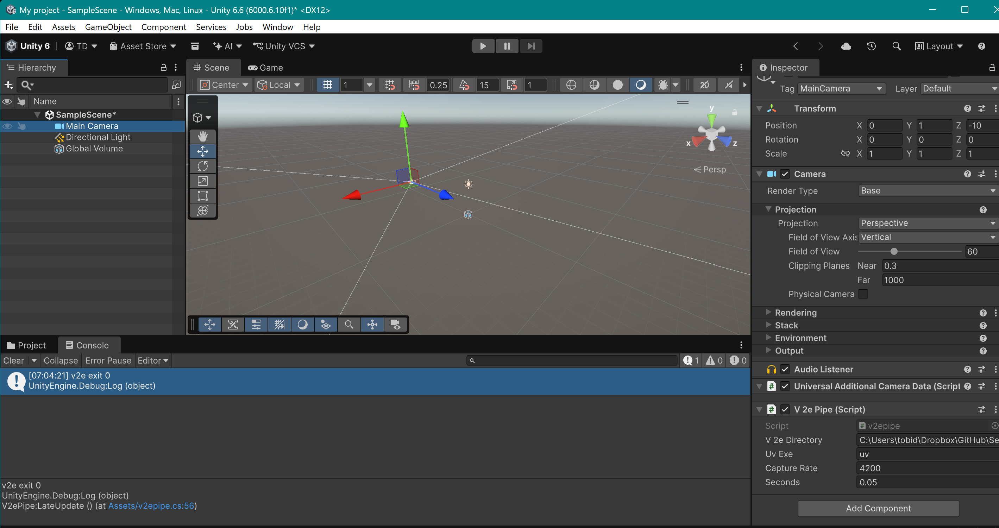

# Unity example: pipe frames into v2e

Press Play in Unity. The `V2ePipe` script on **Main Camera** starts v2e, renders a moving cube at 4200 frames per second of simulated time for 0.05 s, and writes those frames to v2e's standard input. You do not start v2e yourself.



While frames are sent, the Console prints the simulated time completed over the total, about ten times during the capture:

```
v2e 0.005/0.050 s
v2e 0.010/0.050 s
```

The line `v2e exit 0, 0.050/0.050 s` is the end of the run. The events are in the v2e checkout:

`output/unity-pipe/events.aedat4`

v2e does not save the rendered frames as image files. Open that AEDAT-4 file in [jAER](https://jaerproject.org).

A v2e command typed in a terminal is a different process. Its standard input is that terminal, so Unity's frames never reach it, and its output folder stays at the empty header written at startup.

## Scene

Use Unity 6, default 3D template (the screenshot is the URP sample scene). Set **Edit → Project Settings → Player → Color Space** to **Linear** (should already be default). v2e applies its own linlog to the 0–255 pixel values, so the bytes should come from a linear render target.

The default scene already has **Main Camera**, a light, and (in URP) a Global Volume. The script creates the cube.

## Put the script on Main Camera

1. In the **Project** window, use **Assets** menu and choose **Create → MonoBehaviour Script**. Name it `V2ePipe`. The file name and the class name must match.
2. Replace the contents of `Assets/V2ePipe.cs` with the script below. Save, and wait until Unity finishes compiling.
3. In the **Hierarchy**, click **Main Camera**.
4. At the bottom of the **Inspector**, click **Add Component**, type `V2ePipe`, and choose it.

Set **V2e Directory** to the v2e checkout, for example `C:\Users\tobid\Dropbox\GitHub\SensorsINI\v2e`. **Uv Exe** is `uv` when that command is on the Editor's PATH. If Play cannot find it, set **Uv Exe** to the full path from `where.exe uv`.

**Capture Rate** `4200` is just above the 4189 Hz source rate required by the default `--cutoff_hz=200`. **Seconds** `0.05` is about 210 frames. Raise **Seconds** for a longer recording. Each extra second is 4200 readbacks, and v2e converts them slower than Unity renders them, so Play waits on the pipe.

## What you should see

Press Play. Unity's status bar stays in Play. The Game view can look still, because simulated time is advancing at 4200 Hz while each frame is read back and sent to v2e.

When the capture interval has elapsed, the script closes v2e's input and waits for v2e to exit. The Console line (lower left of window) then shows:

```
v2e exit 0, 0.050/0.050 s
```

That line is the completion message, from `V2ePipe.LateUpdate`. The two numbers are simulated seconds completed and `Seconds` on the component. Stop Play after it appears.

The event file is

`<v2e directory>/output/unity-pipe/events.aedat4`

The first Play that reaches this path creates `output/unity-pipe`. A folder named `output/pipe-frames` belongs to a v2e you launched in a terminal. Leave that process stopped (Ctrl+C) while using this scene.

## Script

`Time.captureFramerate` is Unity's fixed-step recorder, described in [Capturing frame rate](https://docs.unity.com/en-us/engine/7000.0/manual/scripting/managing-time-and-frame-rate/time-capture-frame-rate). Each `LateUpdate` is one simulated frame of length `1/4200` s. The frame is read with [Texture2D.ReadPixels](https://docs.unity.com/en-us/engine/7000.0/script-reference/unityengine/texture2d/readpixels) and sent as a PNG with [EncodeToPNG](https://docs.unity.com/en-us/engine/7000.0/script-reference/unityengine/imageconversion/encodetopng).

The record is little-endian: `float64` simulated time in seconds, `uint32` byte count, then the PNG bytes. The write goes to `StandardInput.BaseStream` of the v2e process this script started.

```csharp
using System.Diagnostics;
using System.IO;
using UnityEngine;

public class V2ePipe : MonoBehaviour
{
    public string v2eDirectory = @"C:\Users\tobid\Dropbox\GitHub\SensorsINI\v2e";
    public string uvExe = "uv";
    public int captureRate = 4200;
    public float seconds = 0.05f;

    Process v2e;
    Stream stdin;
    RenderTexture rt;
    Texture2D tex;
    Camera cam;
    Transform cube;
    float loggedThrough;

    string Clock(float t)
    {
        float shown = Mathf.Min(t, seconds);
        return shown.ToString("0.000") + "/" + seconds.ToString("0.000") + " s";
    }

    void Start()
    {
        Time.captureFramerate = captureRate;
        loggedThrough = 0f;
        UnityEngine.Debug.Log("v2e " + Clock(0f));
        cam = GetComponent<Camera>();
        rt = new RenderTexture(346, 260, 24, RenderTextureFormat.ARGB32, RenderTextureReadWrite.Linear);
        tex = new Texture2D(346, 260, TextureFormat.RGB24, false);

        var go = GameObject.CreatePrimitive(PrimitiveType.Cube);
        cube = go.transform;

        var psi = new ProcessStartInfo
        {
            FileName = uvExe,
            Arguments = "run v2e --pipeframes --dvs346 --overwrite --no_preview --skip_video_output --output_folder=output/unity-pipe",
            WorkingDirectory = v2eDirectory,
            UseShellExecute = false,
            RedirectStandardInput = true,
            CreateNoWindow = true
        };
        v2e = Process.Start(psi);
        stdin = v2e.StandardInput.BaseStream;
    }

    void Update()
    {
        cube.position = new Vector3(Mathf.Sin(Time.time * 20f) * 0.4f, 0f, 0f);
    }

    void LateUpdate()
    {
        if (stdin == null)
            return;
        if (Time.time >= seconds)
        {
            stdin.Close();
            stdin = null;
            v2e.WaitForExit();
            UnityEngine.Debug.Log("v2e exit " + v2e.ExitCode + ", " + Clock(seconds));
            return;
        }

        float step = seconds / 10f;
        if (step > 0f && Time.time >= loggedThrough + step)
        {
            loggedThrough = Time.time;
            UnityEngine.Debug.Log("v2e " + Clock(Time.time));
        }

        cam.targetTexture = rt;
        cam.Render();
        RenderTexture.active = rt;
        tex.ReadPixels(new Rect(0, 0, rt.width, rt.height), 0, 0);
        tex.Apply();
        cam.targetTexture = null;
        RenderTexture.active = null;

        byte[] png = tex.EncodeToPNG();
        stdin.Write(System.BitConverter.GetBytes((double)Time.time), 0, 8);
        stdin.Write(System.BitConverter.GetBytes(png.Length), 0, 4);
        stdin.Write(png, 0, png.Length);
        stdin.Flush();
    }

    void OnDestroy()
    {
        if (stdin != null)
            stdin.Close();
        if (rt != null)
            rt.Release();
    }
}
```
